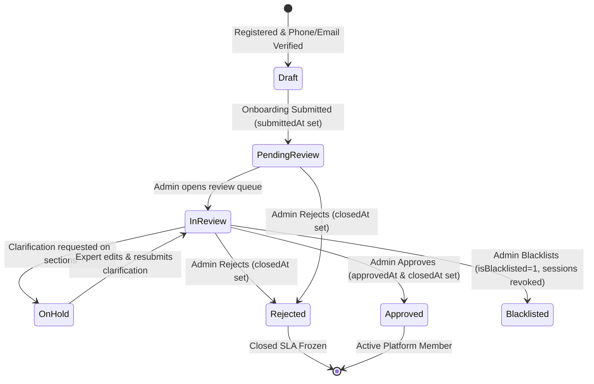

# Jatayu Platform — System Architecture & Context Provider

> **Role & Purpose of this File**: This document serves as the foundational context provider for AI coding agents and developers working on the Jatayu codebase. Read this file first to gain an immediate, accurate, and comprehensive understanding of the project's architecture, domain models, database schema, business lifecycles, design system, and key technical conventions.

---

## 1. Project Overview & Mission

**Jatayu** is a high-performance 1-on-1 expert consultation and mentorship marketplace. It connects **Seekers** (clients seeking strategic advice, career coaching, technical mentoring, or consulting) with vetted, industry-leading **Experts** across software engineering, business strategy, product management, design, legal, and growth marketing.

The platform provides:
- **Seeker Journey**: Search & discovery, schedule booking, secure payments (Razorpay & platform credit wallet), in-browser low-latency video sessions (Agora RTC), automated session transcription, and post-session review/report delivery.
- **Expert Journey**: Comprehensive onboarding (identity, bio, credentials, pricing, weekly availability, KYC verification), profile administration, booking request management, calendar synchronization, and automated payout tracking.
- **Admin Operation Center**: End-to-end applicant vetting with fine-grained per-section decisions (`approve`, `reject`, `clarification`), audit logging, SLA deadline enforcement, live user management, platform dispute resolution, and GMV analytics.

---

## 2. Technology Stack & Monorepo Structure

The repository is structured as a full-stack monolith containing two primary subsystems:

```
Jatayu/
├── backend/                  # Node.js (ES Modules) Express API & WebSocket Server
│   ├── config/               # Database, Razorpay, Swagger, & service configurations
│   ├── controllers/          # Request handlers for admin, expert, seeker, auth
│   ├── models/               # Sequelize ORM models (MySQL)
│   ├── routes/               # Express route definitions
│   ├── scripts/              # Automated DB migration and maintenance scripts
│   ├── services/             # Core business services (notifications, Agora, extensions)
│   └── utils/                # Sanitizers, audit log helpers, formatters, tokens
├── jatayu-frontend-main/     # Next.js 16 (App Router + Turbopack) Frontend
│   ├── app/                  # App Router routes & layouts
│   ├── components/           # Reusable UI, admin, expert, seeker, and auth components
│   ├── hooks/                # Custom React hooks (e.g. useExpertApplications)
│   ├── lib/                  # API clients, store logic, mappers, domain types
│   └── public/               # Static assets, branding, portraits, icons
├── docker-compose.yml        # Multi-container orchestration (MySQL, Redis, etc.)
└── context.md                # System context provider (this file)
```

### Backend Tech Stack
- **Runtime**: Node.js (ES Modules `"type": "module"`)
- **Web Framework**: Express 4.19+ with CORS, `express.json()`, and static file serving
- **Database & ORM**: MySQL 8.x managed through **Sequelize 6.37+** with automated startup column migrations
- **Real-Time Layer**: Socket.IO 4.8+ for notifications, in-session messaging, and live session updates
- **Video & Transcription**: Agora RTC SDK (`agora-token`, `agora-rtc-sdk-ng`)
- **Payments**: Razorpay 2.9+ (Order creation, webhook signature validation, credit wallet transactions)
- **External Integrations**: Twilio (SMS OTP), Brevo / Nodemailer (Transactional email), DigiLocker (Identity verification)
- **API Documentation**: Swagger UI Express (`/api-docs`)

### Frontend Tech Stack
- **Framework**: Next.js 16.2+ (App Router with Turbopack bundler)
- **Language**: TypeScript 5.x (Strict mode)
- **UI Library**: React 19.x with React DOM 19
- **Styling**: Tailwind CSS v4, CSS Modules (`.module.css`), Radix UI primitives, Lucide React icons
- **Animation & 3D**: Motion (formerly Framer Motion), Three.js, React Three Fiber, GSAP
- **Dates & Math**: Day.js, custom ISO duration formatters

---

## 3. Database Architecture & Multi-DB Configuration

The backend supports a multi-database topology via `backend/config/db/index.js`, allowing logical isolation while sharing connection pools:
1. **`expertDb`** (`jatayu_expert_db` or consolidated `DB_NAME`): Expert user profiles, credentials, availability, KYC documents, and sessions.
2. **`seekerDb`** (`jatayu_seeker_db`): Seeker accounts, bookings, reviews, credit ledger, and payments.
3. **`adminDb`** (`jatayu_admin_db`): Platform administrators, audit trails, and global system settings.

### Core Sequelize Models & Relationships
- **`Expert`** (`backend/models/Expert.js`):
  - Primary user identity for advisors.
  - Columns: `id`, `applicationNumber`, `fullName`, `email`, `phone`, `status`, `onboardingStep`, `onboardingMetadata`, `submittedAt`, `approvedAt`, `closedAt`, `reviewerNote`, `isBlacklisted`, `blacklistedAt`, `formatPrices`, `skills`, `targetAudience`, `focusAreas`, `timezone`.
  - Associations:
    - `hasMany(Credential)` (degrees, positions)
    - `hasMany(Availability)` (recurring weekly slots)
    - `hasOne(DigilockerVerification)` (KYC documents)
    - `hasMany(ExpertSession)` (active user sessions)
- **`Seeker`** (`backend/models/seeker/Seeker.js`):
  - Client accounts booking consultations.
  - Associations: `hasMany(Booking)`, `hasMany(SeekerCreditTransaction)`.
- **`Booking`** (`backend/models/seeker/Booking.js`):
  - Consultation reservations between a Seeker and an Expert.
  - Associations: `hasOne(BookingReview)`, `hasMany(BookingPayment)`, `hasOne(BookingTranscriptSession)`, `hasMany(BookingMessage)`, `hasOne(BookingExtension)`.

### Database Auto-Migration System (`migrateExpertColumns.js`)
Rather than relying on manual SQL migrations, `backend/scripts/migrateExpertColumns.js` runs automatically on database initialization (`backend/config/db/index.js`):
- Checks column existence via `INFORMATION_SCHEMA.COLUMNS` (supporting case-insensitive table names `Experts` and `experts`).
- Adds missing columns dynamically (`onboardingMetadata`, `applicationNumber`, `submittedAt`, `approvedAt`, `closedAt`, `reviewerNote`, `isBlacklisted`, `blacklistedAt`).
- Ensures compound performance indexes (`idx_experts_approved_updated`, `idx_experts_closed_updated`, `idx_experts_status_submitted_updated`).
- Idempotently backfills historical rows (e.g., synchronizing `closedAt` from `approvedAt` or `blacklistedAt`/`updatedAt`).

---

## 4. Domain Lifecycles & State Machines

### 4.1 Expert Onboarding & Application Lifecycle



#### Status Enum Mapping
| Frontend Status | Backend Status (`expert.status`) | Meaning |
| :--- | :--- | :--- |
| `pending` | `pending_review` (or completed `draft`) | Application submitted, waiting for initial triage. |
| `in_review` | `in_review` | Administrator is actively examining credentials and KYC. |
| `on_hold` | `on_hold` | One or more sections require clarification from the expert. |
| `approved` | `approved` | Expert passed vetting; allowed full access to dashboard. |
| `rejected` | `rejected` | Application declined. Access restricted. |
| `blacklisted`| `isBlacklisted = true` | Refused permanently. All active sessions immediately revoked. |

#### Section Review Decisions & Clarifications (`onboardingMetadata`)
Admin review operates on a modular per-section basis stored inside `expert.onboardingMetadata`:
- **`sectionDecisions`**: Key-value map of section IDs (`category`, `experience`, `credentials`, `pricing`, etc.) to decision states (`approve`, `reject`, `clarification`).
- **`sectionClarifications`**: Notes requested by admin, response status (`waiting` | `received`), and historical threads.
- **`sectionAuditLogs`**: Append-only timestamped audit trail tracking who made each decision, previous decisions, and notes.
- **Section Form Accordion**: In the expert portal, when placed on hold with clarifications, the expert sees an interactive accordion of forms. Approved sections are locked (read-only); rejected or clarification-requested sections are editable with inline clarification alert boxes and direct "Save Changes" triggers that auto-scroll to the next section needing attention.

---

### 4.2 SLA Calculation & Closed SLA Freeze Rules

1. **Active Countdown SLA**:
   - For open applications (`pending`, `in_review`, `on_hold`), the SLA timer runs against current wall-clock time: `elapsed = Date.now() - submittedAt`.
   - SLA limit is **48 hours**.
   - `< 40 hours`: `on_track` (e.g. `12:30 hrs`).
   - `40–48 hours`: `at_risk` (amber).
   - `≥ 48 hours`: `breached` (red, formatted as `02D:14HR`).
2. **Terminal Closed SLA Freeze (`closedAt`)**:
   - Once an application is **Approved**, **Rejected**, or **Blacklisted**, its SLA stops ticking forever.
   - Elapsed duration is computed between `submittedAt` and `closedAt`.
   - Rendered using the clean, neutral **Closed SLA** formatter:
     - `< 1 min`
     - `8 mins`, `16 mins`
     - `2 hrs 11 mins`
     - `3 days 2 hrs`, `7 days 2 hrs`
   - Styled with `.slaClosed` (neutral ink text, never red).
3. **Overdue Calculation Invariant**:
   - **Crucial Rule**: Terminal states (`rejected`, `approved`, `blacklisted`, or applications with `closedAt`) must **NEVER** be counted in `counts.overdue` or trigger overdue warning banners.
   - Overdue strictly represents active applications requiring admin triage that have exceeded 48 hours.

---

## 5. Portal Architecture & Key Routes

### 5.1 Admin Portal (`/admin/...`)
Located in `jatayu-frontend-main/app/admin/` and `components/admin/`:
- **Overview Dashboard** (`/admin/dashboard`, `AdminOverviewDashboard.tsx`):
  - GMV 14-day trend line/area chart, session breakdown, recent platform events.
  - **Dynamic Overdue Alert Banner**: Monitors `overdueCount`. If `overdueCount === 0`, it is **completely hidden**. If $>0$, displays overdue count with an urgent alert and a "Review Now" button linking to `/admin/applications?filter=overdue#kpi-card-overdue`.
- **Expert Applications Queue** (`/admin/applications`, `ExpertApplications.tsx`):
  - Chamfer KPI filter cards: `Total`, `Pending`, `In Review`, `On Hold`, `Overdue`, `Rejected`.
  - Advanced multi-column filter table (name, category, language, date, SLA status, reviewer).
  - Deep-link support: Automatically activates the Overdue filter and scrolls to `#kpi-card-overdue` when navigated with `?filter=overdue`.
- **Application Review & Detail** (`/admin/review/[appId]`, `ReviewStep.tsx`):
  - Full application inspection (KYC documents, video check, degrees, work history).
  - Section-by-section approval/clarification controls with instant audit logging.
- **Rejection & Hold Decisions** (`/admin/rejection-hold/[appId]`, `RejectionHoldHandling.tsx`):
  - Pre-filled email and WhatsApp template dispatch for candidate rejection or revision requests.
- **User Management** (`/admin/users`, `UserManagement.tsx`):
  - Consolidated directory of Experts and Seekers.
  - Lists "Closed SLA", total sessions, GMV generated, and quick action toggles (`Active`, `On Hold`, `Suspended`, `Blacklist`).

### 5.2 Expert Portal (`/expert/...`)
Located in `jatayu-frontend-main/app/expert/` and `components/expert/`:
- **Expert Onboarding** (`/expert/expert-onboarding`): Multi-step registration (Category, Credentials, Experience, Weekly Availability, Pricing, KYC, Final Review).
- **Restricted Access Mode**:
  - While an application is pending or in review, sensitive pages (`Dashboard`, `Availability & Calendar`, `Requests`, `Earnings`, `Reviews`, `Achievements`, `Notifications`, `Settings`) are rendered in a blurred, non-interactive state with an unapproved banner.
- **Availability & Weekly Schedule** (`/expert/availability`, `ExpertAvailability.tsx`):
  - Weekly recurring time slot blocks (Start Time, End Time, Mon–Sun toggle badges).
  - Custom date exceptions (blackout dates / holidays).
  - Timezone detection and conversion (`Intl.DateTimeFormat`).

### 5.3 Seeker Portal (`/seeker/...`)
Located in `jatayu-frontend-main/app/seeker/` and `components/seeker/`:
- **Discover & Profile** (`/seeker/discover`, `/seeker/expert/[slug]`): Filter specialists by category, rating, price, and language.
- **Checkout & Credit Ledger**: Book time slots using Razorpay or wallet balance.
- **Video Consultation**: Agora-powered audio/video room with live transcription streams.

---

## 6. Design System & Frontend Styling Conventions

The platform follows a custom, precision-crafted **Jet-Black / Industrial Chamfer** aesthetic.

### 6.1 Color Tokens (`globals.css`)
```css
:root {
  /* Darks */
  --bunker: #080A10;          /* Deepest background surface */
  --woodsmoke: #14171D;       /* Card background */
  --ink: #0B0D14;             /* Primary text & high contrast */
  
  /* Accents */
  --pomegranate: #E53B17;     /* Brand primary red / breached alert */
  --thunderbird: #D63614;     /* Deep warning */
  --tango: #E9681E;           /* Amber / at-risk SLA */
  --green: #34C759;           /* Positive status / approvals */
  
  /* Grays & Lights */
  --mercury: #E6E6E6;         /* Default border tone */
  --seashell: #F1F1F1;        /* Light surface fill */
  --white: #FFFFFF;
  --dove-gray: #686868;       /* Subtitle & muted text */
}
```

### 6.2 Typography Tokens
- **`--font-display`**: `Sora`, sans-serif (Headers, hero metrics)
- **`--font-body`**: `Inter`, sans-serif (Body text, UI labels)
- **`--font-mono`**: `IBM Plex Mono`, monospace (Timers, SLAs, application IDs, code)
- **`--font-num`**: `Roboto`, sans-serif (Tabular numeric figures)

### 6.3 Chamfer Card Pattern
Cards frequently utilize cut-corner (chamfered) polygons with synchronized SVG borders:
- Defined in `components/homepage/Problem.module.css` as `.scardMini` and `.chamferSvg`.
- Polygon stroke dynamically reflects hover and active filter states (`.kpiCardActive`).

---

## 7. Development, Build & Verification Commands

### Backend Commands (run from `backend/`)
```bash
# Start backend in development mode with watch
npm run dev

# Run automated DB column & index migration manually
npm run migrate:expert-columns

# Start in production mode
npm start
```

### Frontend Commands (run from `jatayu-frontend-main/`)
```bash
# Start Next.js local development server (Turbopack)
npm run dev

# Run strict TypeScript verification (no emit)
npx tsc --noEmit

# Execute production build (turbopack App Router compilation)
npm run build
```

---

## 8. Critical Agent Invariants & Guardrails

When modifying or extending this codebase, **always adhere to the following rules**:

1. **Closed SLA Calculation**:
   - Never compute SLA for approved, rejected, or blacklisted records using `Date.now()`. Always calculate elapsed time against `closedAt` (or fallback `approvedAt`/`blacklistedAt`/`updatedAt`).
   - Use `formatClosedSlaDuration` in `expertApplicationsStore.ts` to keep closed durations uniform across the app.
2. **Overdue Metric Filtering**:
   - When calculating overdue applications (in backend controllers or frontend hooks), always ensure `isTerminal` filter is applied: `status NOT IN ('rejected', 'approved') AND !isBlacklisted AND !closedAt`.
3. **Database Column Additions**:
   - Never assume all database tables across staging and production have new columns. Always add new columns to `EXPERT_COLUMN_DEFINITIONS` in `backend/scripts/migrateExpertColumns.js` with idempotent `columnExists` verification and fallback backfill queries.
4. **Preserve `approvedAt` vs `closedAt`**:
   - `approvedAt` is strictly reserved for the date an expert was accepted and became an active member (`joinedDate`).
   - `closedAt` records when the review concluded (accepted OR rejected). Do not use `closedAt` as member join date for rejected candidates.
5. **Next.js App Router Hydration**:
   - When inspecting search parameters (e.g. `?filter=overdue`), execute inspection inside `useEffect` or wrap the component in `<Suspense>` to avoid client-side de-optimization.
6. **Code Style & Imports**:
   - Backend uses native ES Modules (`import/export`, with file extensions `.js` required in relative imports).
   - Frontend components use CSS Modules (`styles.className`). Avoid hardcoded inline style colors; use CSS variables (`var(--pomegranate)`, `var(--ink)`).

